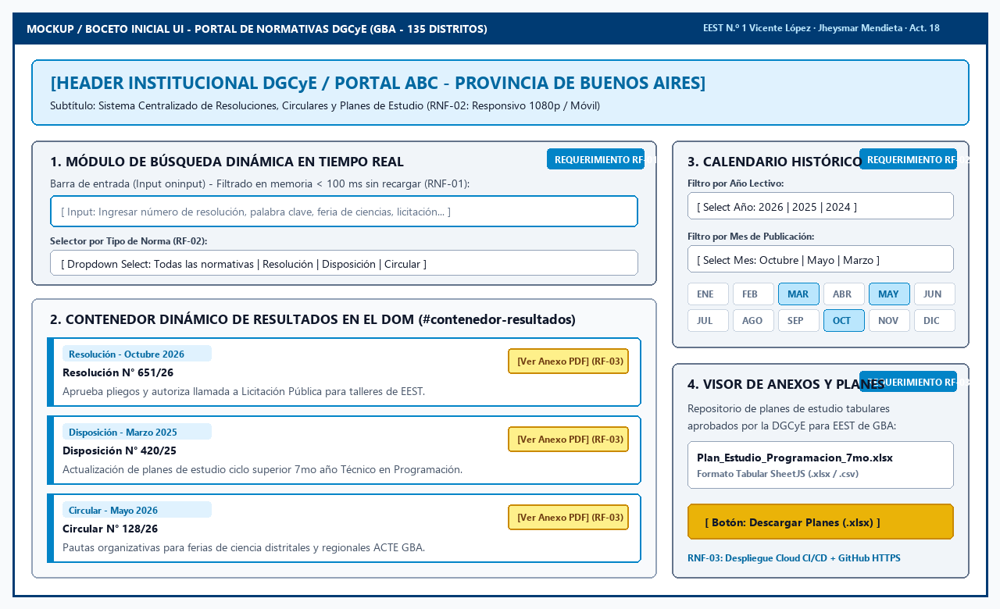

# 📋 Documento de Especificación de Requerimientos del Sistema (SRS) — Caso DGCyE (GBA)

**Materia:** Proyecto de Implementación de Sitios Web Dinámicos  
**Institución:** EEST N.º 1 "Eduardo Ader" — Vicente López  
**Curso:** 7.° Año 2.° Grupo B  
**Estudiante:** Jheysmar Mendieta  
**Docente:** Prof. York Elías Mansilla Muñoz  
**Actividad 18:** Levantamiento de Requerimientos y Entrevista con el Cliente (Caso DGCyE - GBA)

---

## 1. Minuta de Entrevista con el Cliente (Resumen de 5 Líneas)

1. Los directores de área, inspectores y docentes de escuelas técnicas de la **DGCyE (GBA)** requieren un portal web centralizado que elimine las demoras al buscar resoluciones, disposiciones, circulares y planes de estudio dispersos en archivos PDF caóticos.
2. El cliente solicita un **buscador dinámico por palabras clave** que filtre los documentos en tiempo real a medida que el usuario escribe, sin recargar la página web.
3. Es indispensable incorporar un **calendario histórico y selector de categorías** para auditar normativas por año, mes y tipo de instrumento legal (*Resolución*, *Disposición*, *Circular*).
4. El sistema debe incluir un **panel de visualización rápida y descarga directa de anexos**, tales como documentos normativos en formato `.pdf` y grillas tabulares de planes de estudio en formato Excel (`.xlsx`).
5. La aplicación debe garantizar un **rendimiento fluido (`< 100 ms` en memoria RAM del cliente)**, diseño responsivo adaptable tanto a computadoras del Estado (1080p) como a teléfonos celulares, y despliegue continuo en la nube con HTTPS conectado a GitHub.

---

## 2. Especificación de Requerimientos del Sistema (SRS)

### A. Requerimientos Funcionales (Lo que el sistema DEBE hacer)

| Código | Nombre del Requerimiento | Descripción Funcional | Prioridad |
| :--- | :--- | :--- | :---: |
| **RF-01** | **Búsqueda Dinámica en Tiempo Real** | El usuario debe poder ingresar términos o números de norma en una barra de búsqueda (`<input>`) y filtrar normativas o resoluciones de forma instantánea (`oninput`) sin recargar la pantalla. | Alta |
| **RF-02** | **Filtro por Categorías y Calendario Histórico** | El sistema debe permitir seleccionar y segmentar resoluciones por año, mes (mediante un calendario histórico interactivo) y tipo de norma (*Resolución*, *Disposición*, *Circular*). | Alta |
| **RF-03** | **Visor de Anexos y Descarga Directa** | La interfaz debe mostrar en cada tarjeta de resultado y en el panel lateral los documentos oficiales asociados (resoluciones en `.pdf` y grillas de planes de estudio en formato tabular `.xlsx`) con opción de visualización y descarga directa. | Alta |

---

### B. Requerimientos No Funcionales (Cómo debe comportarse el sistema)

| Código | Atributo de Calidad | Especificación Técnica yMétrica de Aceptación |
| :--- | :--- | :--- |
| **RNF-01** | **Rendimiento (Performance)** | El filtrado de datos debe ejecutarse del lado del cliente en memoria RAM utilizando métodos funcionales de JavaScript (`Array.prototype.filter()` y `String.prototype.includes()`) en un tiempo **menor a `100 ms`** para garantizar una tasa de refresco fluida de `60 fps`. |
| **RNF-02** | **Compatibilidad y Responsividad** | El diseño de interfaz de usuario (UI) debe emplear CSS Grid/Flexbox con *media queries* para adaptarse perfectamente a pantallas de dispositivos móviles (smartphones de docentes e inspectores) y monitores de escritorio institucionales (`1080p`). |
| **RNF-03** | **Seguridad y Despliegue Cloud (CI/CD)** | La aplicación debe contar con despliegue automático en la nube (Vercel / Render / GitHub Pages) bajo protocolo seguro **HTTPS** mediante integración continua (CI/CD) conectada a la rama `main` de **GitHub**. |

---

### C. Modelo de Datos Inicial (Estructura JSON Simulada en JavaScript)

```javascript
// =============================================
// BASE DE DATOS LOCAL DE NORMATIVAS (DGCyE - GBA)
// =============================================
// Este array almacena objetos con la información institucional
// que la aplicación web va a mostrar, filtrar y buscar dinámicamente.

const normativasDGCyE = [
  {
    id: 1,
    nro: "651/26",
    tipo: "Resolución",
    anio: 2026,
    mes: "Octubre",
    desc: "Aprueba pliegos y autoriza llamada a Licitación Pública para talleres de EEST."
  },
  {
    id: 2,
    nro: "420/25",
    tipo: "Disposición",
    anio: 2025,
    mes: "Marzo",
    desc: "Actualización de planes de estudio ciclo superior 7mo año Técnico en Programación."
  },
  {
    id: 3,
    nro: "128/26",
    tipo: "Circular",
    anio: 2026,
    mes: "Mayo",
    desc: "Pautas organizativas para ferias de ciencia distritales y regionales ACTE GBA."
  }
];

// ==========================================
// EJEMPLO DE USO RÁPIDO PARA EL FRONTEND
// ==========================================
// Muestra por consola cómo recorrer el arreglo y filtrar por año o tipo de norma.
console.log("Listado total de normativas cargadas:", normativasDGCyE.length);

// Ejemplo de filtrado por año (útil para el buscador del sitio web)
const normativas2026 = normativasDGCyE.filter(normativa => normativa.anio === 2026);
console.log("Normativas del año 2026:", normativas2026);
```

---

## 3. Mockup o Boceto Inicial de la Interfaz Principal

A continuación se presenta el boceto digital (wireframe) de la interfaz principal en dos columnas diseñada para la DGCyE:



### Esquema Estructural de Componentes UI

```text
+-----------------------------------------------------------------------------------+
| [HEADER INSTITUCIONAL DGCyE - PBA]                                                |
| Buscador Oficial de Normativas, Resoluciones y Planes de Estudio (135 Distritos)  |
+---------------------------------------------------------+-------------------------+
| COLUMNA PRINCIPAL (2fr): BUSCADOR Y RESULTADOS          | COLUMNA LATERAL (1fr)   |
| +-----------------------------------------------------+ | +---------------------+ |
| | [Input: Buscar por número, palabra clave...] (RF-01)| | | CALENDARIO HISTÓRICO| |
| | [Select Tipo: Todas | Resolución | Disposición...]  | | | [Año: 2026 | 2025]  | |
| +-----------------------------------------------------+ | | [Mes: Octubre | ...]| |
|                                                         | |---------------------| |
| +-----------------------------------------------------+ | | ANEXOS Y GRILLAS    | |
| | [Resolución - Octubre 2026]             [Ver PDF]   | | | Planes de Estudio   | |
| | Resolución N° 651/26                                | | | Oficiales EEST GBA  | |
| | Aprueba pliegos y autoriza Licitación Pública...    | | | [Descargar (.xlsx)] | |
| +-----------------------------------------------------+ | +---------------------+ |
| +-----------------------------------------------------+ |                         |
| | [Circular - Mayo 2026]                  [Ver PDF]   | |                         |
| | Circular N° 128/26                                  | |                         |
| | Pautas organizativas para ferias de ciencia ACTE... | |                         |
| +-----------------------------------------------------+ |                         |
+---------------------------------------------------------+-------------------------+
```
